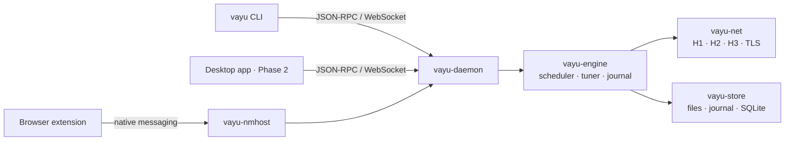

<div align="center">


# vayu

**The download manager that proves it is fast.**<br>
বায়ু: open-source, crash-proof, and measured against every competitor in public.

[](LICENSE.md)
[](crates)
[](#roadmap)
[](MASTER-PLAN.md)
[-2f74ec)](CONTRIBUTING.md)

[Benchmarks](#measured-not-claimed) · [Features](#what-the-engine-does-today) · [Quick start](#quick-start) · [Roadmap](#roadmap) · [Contributing](#contributing)

</div>

---

> **Status: Phase 1 (the engine) is in its release gate.** The engine, daemon and CLI work today on Linux. The desktop app and the browser extension arrive in Phase 2 (v1.0). `vayu` is a working codename.

## Measured, not claimed

Every number below comes from [`vayu-bench`](crates/bench). It runs vayu and nine other downloaders against [`labserver`](crates/labserver), a test server that throttles, drops, stalls, lies about ranges, rotates files and redirects. Each case is run 7 times, compared with a Mann-Whitney U test, and timed **until the file is safely on disk**. Raw data for every run is committed in [`docs/bench/data`](docs/bench/data).

| | vayu | Best competitor |
|---|---|---|
| **Correct files** | **175 / 175 runs byte-exact**, 0 wrong names | Gopeed: 14 corrupt files · Surge: 3 corrupt files |
| **Crash test**: 1,000 × `kill -9` mid-download | **0 corrupt, 0 duplicates** (1,701 downloads) | not measured by anyone else |
| **CPU per GiB** (1 GiB file) | **0.72 CPU-s** | 1.43 CPU-s (aria2c, 16 connections) |
| **Flaky server**, 100 MiB | **0.141 s**, fastest | aria2-next 0.150 s |
| **Stalling server**, 100 MiB | **0.151 s**, fastest | 0.167 s+ |
| **Slow-drip server**, 10 MiB | **0.306 s**, fastest | Gopeed 0.303 s, tied |

<sub>Run set <a href="docs/bench/data/2026-11-12-pop-os-phase1-gate2/report.md">2026-11-12-pop-os-phase1-gate2</a>: Pop!_OS, loopback. Competitors: curl, wget, aria2c, aria2-next, Mister DM, Surge, Gopeed. Lower CPU is better.</sub>

vayu doesn't call a download done until the bytes are synced to disk, so a power cut or load-shedding never leaves a broken file. The other clients leave data in the page cache, so the benchmark syncs their files too before it stops the clock.

## What the engine does today

- **Every HTTP:** HTTP/1.1, HTTP/2 and HTTP/3 (QUIC) over TLS, with Happy Eyeballs.
- **Smart connections:**
  - starts on one connection and measures it;
  - adds connections only when they really help, and drops back when they don't;
  - remembers each host's limits.
- **Work-stealing segments** with hedged requests, so one slow connection never holds up the tail.
- **Crash-proof resume:**
  - preallocated files and a write-ahead journal;
  - tail verification after a crash;
  - changed files on the server are detected and restarted cleanly.
- **Lean I/O:** writes go to disk on the caller's thread while the data is still in the CPU cache; flushes run on their own thread.
- **Real-world servers:**
  - cookies, referers and custom headers;
  - redirect chains and expiring signed URLs;
  - servers without ranges or lengths;
  - Bangla and other Unicode file names (RFC 5987), with path-traversal protection.
- **Download manager basics:** queues, categories, a global speed limit, pause and resume, checksums, mirrors.
- **One daemon, many clients:**
  - `vayu-daemon` with a local, token-protected JSON-RPC/WebSocket API ([protocol](docs/api/PROTOCOL.md));
  - the `vayu` CLI;
  - a native-messaging host for the browser extension.

## Quick start

```bash
# build (Rust toolchain pinned in rust-toolchain.toml)
cargo build --release -p vayu-cli -p vayu-daemon

# download: the daemon starts on first use and keeps running
target/release/vayu get https://example.com/big.iso -o ~/Downloads

# queue a few, watch them, inspect one
target/release/vayu add https://example.com/a.zip https://example.com/b.zip --queue night
target/release/vayu watch
target/release/vayu info <id>
```

All commands are listed in [`crates/cli`](crates/cli/README.md). To benchmark on your own machine, see [`docs/bench`](docs/bench/README.md).

## Architecture



| Path | What |
|---|---|
| [`crates/core`](crates/core) | engine types and traits (ranges, sources, storage, journal) |
| [`crates/net`](crates/net) · [`engine`](crates/engine) · [`store`](crates/store) | network, scheduling, durable storage |
| [`crates/daemon`](crates/daemon) · [`cli`](crates/cli) · [`nmhost`](crates/nmhost) | the service and its clients |
| [`crates/proto`](crates/proto) · [`packages/api-client`](packages/api-client) | the local API, in Rust and TypeScript |
| [`crates/labserver`](crates/labserver) · [`bench`](crates/bench) | fault-injecting test server and benchmark harness |
| [`apps/desktop`](apps/desktop) · [`apps/extension`](apps/extension) · [`packages/ui`](packages/ui) | Tauri app, browser extension, Svelte UI |

## Roadmap

| Phase | Ships | Status |
|---|---|---|
| **0 · Foundations** | monorepo, CI, design system, labserver, bench, baseline report | ✅ done |
| **1 · Engine** | H1/H2/H3 engine, daemon, CLI, crash-proof journal; [public gate](MASTER-PLAN.md#phase-1--engine-months-13) | 🔶 release gate |
| **2 · v1.0** | desktop app (Windows, macOS, Linux), extension Pro mode, self-healing links, yt-dlp, signed installers, Bangla + English | next |
| **3 · v1.5** | BitTorrent, FTP/SFTP, HLS/DASH, multi-source + LAN peers, BDIX mode, Docker, web remote | planned |
| **4 · v2.0** | extension Lite mode (WASM), Android, iOS companion, send-to-device, plugins | planned |

The full plan is in [MASTER-PLAN.md](MASTER-PLAN.md), and decisions are recorded in [docs/adr](docs/adr).

## Contributing

```
feat/your-change ──PR──▶ dev ──release PR──▶ pub ──tag──▶ vX.Y.Z
```

- **`dev`** is where all work lands: open your PR there.
- **`pub`** holds releases only. It takes release PRs from `dev`, and any other PR into it is moved to `dev` automatically.

Setup, rules and commands are in [CONTRIBUTING.md](CONTRIBUTING.md). Please report security issues privately, as described in [SECURITY.md](SECURITY.md).

## License

The engine, protocol and libraries (`crates/`, `packages/`) are **Apache-2.0**, so you can embed them anywhere. The applications (`apps/`) are **GPL-3.0-or-later**. Details are in [LICENSE.md](LICENSE.md).

<sub>Not affiliated with Tonec Inc. "Internet Download Manager" and "IDM" are trademarks of their owner and appear here only for comparison.</sub>
