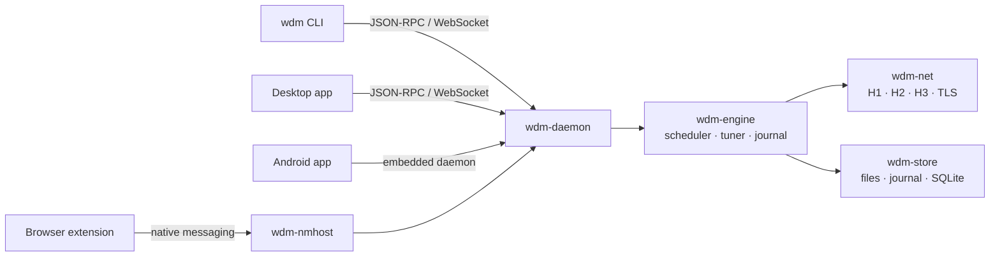

<div align="center">


# Whoosh Download Manager

**WDM: the download manager that proves it is fast.**<br>
Open-source, crash-proof, and measured against every competitor in public.

[](LICENSE.md)
[](crates)
[](https://github.com/coderzonebd/whoosh-download-manager/releases)
[](MASTER-PLAN.md)
[-2f74ec)](CONTRIBUTING.md)

**[Download](https://coderzonebd.github.io/wdm/)** · [Benchmarks](#measured-not-claimed) · [vs IDM](#against-internet-download-manager-on-windows) · [Features](#what-it-does) · [Install](#install) · [Roadmap](#roadmap) · [Contributing](#contributing) · [Support](#support-whoosh-download-manager)

</div>

---

> **Public beta: [v1.0.0-beta.1](https://github.com/coderzonebd/whoosh-download-manager/releases/tag/v1.0.0-beta.1) is out** for Windows, macOS, Linux and Android, with the browser extension for Firefox and Edge. Get it from **[the website](https://coderzonebd.github.io/wdm/)**, which picks the right download for your system. It is a beta: please [report what breaks](https://github.com/coderzonebd/whoosh-download-manager/issues). Benchmark runs recorded before the rename call WDM by its old codename, `vayu`.

## Measured, not claimed

Every number below comes from [`wdm-bench`](crates/bench). It runs Whoosh Download Manager and nine other downloaders against [`labserver`](crates/labserver), a test server that throttles, drops, stalls, lies about ranges, rotates files and redirects. Each case is run 7 times, compared with a Mann-Whitney U test, and timed **until the file is safely on disk**. Raw data for every run is committed in [`docs/bench/data`](docs/bench/data).

| | WDM | Best competitor |
|---|---|---|
| **Correct files** | **175 / 175 runs byte-exact**, 0 wrong names | Gopeed: 14 corrupt files · Surge: 1 corrupt file |
| **Crash test**: 1,000 × `kill -9` mid-download | **0 corrupt, 0 duplicates** (1,584 downloads) | not measured by anyone else |
| **CPU per GiB** (1 GiB file) | **1.26 CPU-s** | 1.51 CPU-s (aria2c, 16 connections) |
| **Flaky server**, 100 MiB | **0.142 s**, fastest | aria2-next 0.216 s |
| **Stalling server**, 100 MiB | **0.169 s**, fastest | Surge 0.199 s |
| **Slow-drip server**, 10 MiB | **0.295 s**, fastest | Gopeed 0.316 s |
| **Real CDNs** (kernel.org/Fastly, Google, Mozilla) | no competitor significantly faster · **lowest CPU on all three** | aria2-next, Mister DM, aria2c `-x16` |

<sub>Run sets <a href="docs/bench/data/2026-11-13-pop-os-phase1-gate4/report.md">2026-11-13-pop-os-phase1-gate4</a>, <a href="docs/bench/data/2026-11-13-pop-os-phase1-hardkill-9665f1b">hardkill-9665f1b</a> and <a href="docs/bench/data/2026-11-13-pop-os-phase1-cdn3/report.md">cdn3</a>: Pop!_OS laptop, loopback and real internet. Times are to the file being safely on disk. Competitors: curl, wget, aria2c, aria2-next, Mister DM, Surge, Gopeed. Lower is better.</sub>

Whoosh Download Manager doesn't call a download done until the bytes are synced to disk, so a power cut or load-shedding never leaves a broken file. The other clients leave data in the page cache, so the benchmark syncs their files too before it stops the clock. That safety has a small fixed cost: on 1 MiB files wget can finish 5–9 ms sooner. The gate allows up to 10 ms on files of 4 MiB or less, and every report lists each row where that allowance applies ([MASTER-PLAN §8](MASTER-PLAN.md#phase-1--engine-months-13)).

### Against Internet Download Manager, on Windows

IDM only runs on Windows, so it gets its own run: the same harness on a GitHub Windows runner, IDM 6.43 (trial) resident as people use it, against WDM and curl. Six scenarios, 5 runs each, repeated in four run sets. Times are medians, from the command to the file safely on disk; lower is better.

| | WDM | IDM 6.43 (its best run set) | curl |
|---|---|---|---|
| **1 GiB, fast server** | **6.2–7.6 s** | 12.4 s | 7.2–9.7 s |
| **Flaky server**, 100 MiB | **0.59–0.68 s** | 0.92 s | fails (no retry) |
| **Stalling server**, 100 MiB | **0.60–0.66 s** | 3.9 s | 8.7–9.2 s |
| **Slow-drip server**, 10 MiB | **0.62–0.72 s** | 5.0 s | 6.7–8.4 s |
| **Per-connection throttle**, 10 MiB | **0.45–0.47 s** | 1.48 s | 5.23 s |
| **High latency**, 10 MiB | **0.60–0.62 s** | 3.8 s | 0.67–0.73 s |

<sub>Run sets <a href="docs/bench/data/2026-11-19-gh-windows-idm-1/report.md">gh-windows-idm-1</a> to <a href="docs/bench/data/2026-11-19-gh-windows-idm-4/report.md">-4</a>; ranges are WDM's and curl's medians across the four sets. Every IDM and WDM run was byte-exact. A runner is a shared virtual machine on loopback, so compare clients within a set, not with the Linux numbers above; real-internet tests against IDM are still to come. How IDM is driven (and kept from stopping on its pop-ups): <a href="docs/bench/README.md#windows-with-idm">docs/bench</a>.</sub>

## What it does

- **Apps for every system:**
  - desktop app for Windows, macOS and Linux, with a tray icon and a classic or modern download list;
  - Android app with the same engine;
  - browser extension (Firefox, Edge, Chrome and other Chromium browsers) that hands downloads to WDM;
  - Bangla, English and ten more languages.
- **Videos and playlists** from YouTube, Facebook and the other sites yt-dlp supports: pick the quality, or audio only. The media tools are fetched in the background after install, so the installers stay small.
- **Updates itself:** the desktop app checks for new versions and updates in place.

### The engine

- **Every HTTP:** HTTP/1.1, HTTP/2 and HTTP/3 (QUIC) over TLS, with Happy Eyeballs.
- **Smart connections:**
  - starts on one connection and measures it;
  - adds connections only when they really help, and drops back when they don't;
  - remembers each host's limits.
- **Work-stealing segments** with hedged requests, so one slow connection never holds up the tail.
- **Crash-proof resume:**
  - preallocated files and a write-ahead journal;
  - tail verification after a crash;
  - changed files on the server are detected and restarted cleanly.
- **Lean I/O:** writes go to disk on the caller's thread while the data is still in the CPU cache; flushes run on their own thread.
- **Real-world servers:**
  - cookies, referers and custom headers;
  - redirect chains and expiring signed URLs;
  - servers without ranges or lengths;
  - Bangla and other Unicode file names (RFC 5987), with path-traversal protection.
- **Download manager basics:** queues, categories, a global speed limit, pause and resume, checksums, mirrors.
- **One daemon, many clients:**
  - `wdm-daemon` with a local, token-protected JSON-RPC/WebSocket API ([protocol](docs/api/PROTOCOL.md));
  - the `wdm` CLI;
  - a native-messaging host for the browser extension.

## Install

The easiest way: open **[coderzonebd.github.io/wdm](https://coderzonebd.github.io/wdm/)**. It detects your system and offers the right installer first.

Or one command, which checks what it downloads; the app keeps itself up to date afterwards:

| System | Command |
|---|---|
| Linux and macOS | `curl -fsSL https://coderzonebd.github.io/wdm/install.txt \| sh` |
| Windows (PowerShell) | `irm https://coderzonebd.github.io/wdm/install.txt \| iex` |
| Android | the `.apk` on the [releases page](https://github.com/coderzonebd/whoosh-download-manager/releases) |

Package managers start with the first full release (1.0.0); betas are not published there:

| System | Command (from 1.0.0) |
|---|---|
| Windows | `winget install --id CoderZoneBD.WDM -e` |
| macOS (Homebrew) | `brew install --cask coderzonebd/tap/whoosh-download-manager` |
| Arch Linux | `yay -S wdm` (AUR) |

The script is the same file for every system: it works out which one it runs on. On Windows it uses winget, else the per-user installer; on macOS Homebrew, else the `.dmg`; on Linux it uses apt (Debian, Ubuntu, Mint), dnf or zypper (Fedora, openSUSE) through the signed WDM repository, else the AppImage (betas have no `.rpm`, so Fedora and openSUSE get the AppImage until 1.0.0). The installers are also on the [releases page](https://github.com/coderzonebd/whoosh-download-manager/releases). How each channel updates: [docs/release.md](docs/release.md#package-channels).

The browser extension: [Firefox Add-ons](https://addons.mozilla.org/firefox/addon/whoosh-download-manager/) and [Microsoft Edge Add-ons](https://microsoftedge.microsoft.com/addons/detail/lbcnfampnnfcbfacehkdjlggmbigpbdh); for Chrome, Brave and other Chromium browsers, the zip on the releases page. The app's *Connect your browser* page links the right one.

The apt and rpm repository is hosted by [Cloudsmith](https://cloudsmith.com), free for open source:
[](https://cloudsmith.com)

## Quick start (from source)

```bash
# build (Rust toolchain pinned in rust-toolchain.toml)
cargo build --release -p wdm-cli -p wdm-daemon

# download: the daemon starts on first use and keeps running
target/release/wdm get https://example.com/big.iso -o ~/Downloads

# queue a few, watch them, inspect one
target/release/wdm add https://example.com/a.zip https://example.com/b.zip --queue night
target/release/wdm watch
target/release/wdm info <id>
```

All commands are listed in [`crates/cli`](crates/cli/README.md). To benchmark on your own machine, see [`docs/bench`](docs/bench/README.md).

## Architecture



| Path | What |
|---|---|
| [`crates/core`](crates/core) | engine types and traits (ranges, sources, storage, journal) |
| [`crates/net`](crates/net) · [`engine`](crates/engine) · [`store`](crates/store) | network, scheduling, durable storage |
| [`crates/media`](crates/media) | video and audio sites: yt-dlp, ffmpeg and Deno as separate programs, fetched and checked in the background after install, downloads through the engine |
| [`crates/daemon`](crates/daemon) · [`cli`](crates/cli) · [`nmhost`](crates/nmhost) | the service and its clients |
| [`crates/proto`](crates/proto) · [`packages/api-client`](packages/api-client) | the local API, in Rust and TypeScript |
| [`crates/labserver`](crates/labserver) · [`bench`](crates/bench) | fault-injecting test server and benchmark harness |
| [`apps/desktop`](apps/desktop) · [`apps/mobile`](apps/mobile) · [`apps/extension`](apps/extension) · [`packages/ui`](packages/ui) | Tauri desktop and Android apps, browser extension, Svelte UI |

## Roadmap

| Phase | Ships | Status |
|---|---|---|
| **0 · Foundations** | monorepo, CI, design system, labserver, bench, baseline report | ✅ done |
| **1 · Engine** | H1/H2/H3 engine, daemon, CLI, crash-proof journal; [public gate](MASTER-PLAN.md#phase-1--engine-months-13) | ✅ done |
| **2 · v1.0** | desktop app (Windows, macOS, Linux), Android app, browser extension, video and playlists (yt-dlp), self-update, signed installers, Bangla + English and ten more languages | 🧪 public beta ([v1.0.0-beta.1](https://github.com/coderzonebd/whoosh-download-manager/releases/tag/v1.0.0-beta.1)); 1.0.0 after testing |
| **3 · v1.5** | BitTorrent (next), FTP/SFTP, HLS/DASH, multi-source + LAN peers, BDIX mode, Docker, web remote | planned |
| **4 · v2.0** | extension Lite mode (WASM), iOS companion, send-to-device, plugins | planned |

The full plan is in [MASTER-PLAN.md](MASTER-PLAN.md), and decisions are recorded in [docs/adr](docs/adr).

## Contributing

```
feat/your-change ──PR──▶ dev ──release PR──▶ pub ──tag──▶ vX.Y.Z
```

- **`dev`** is where all work lands: open your PR there.
- **`pub`** holds releases only. It takes release PRs from `dev`, and any other PR into it is moved to `dev` automatically.

Setup, rules and commands are in [CONTRIBUTING.md](CONTRIBUTING.md). Please report security issues privately, as described in [SECURITY.md](SECURITY.md).

## Support Whoosh Download Manager

Whoosh Download Manager is free, has no ads and does not track you ([privacy](docs/privacy.md)). If it saves you time, you can help keep it going:

- [GitHub Sponsors](https://github.com/sponsors/coderzonebd)
- [Buy Me a Coffee](https://buymeacoffee.com/devrkb21)

Starring the repository, reporting bugs and translating help too.

## License

The engine, protocol and libraries (`crates/`, `packages/`) are **Apache-2.0**, so you can embed them anywhere. The applications (`apps/`) are **GPL-3.0-or-later**. Details are in [LICENSE.md](LICENSE.md).

Made by [Coder Zone BD](https://coderzonebd.com) and contributors.

<sub>Not affiliated with Tonec Inc. "Internet Download Manager" and "IDM" are trademarks of their owner and appear here only for comparison.</sub>
